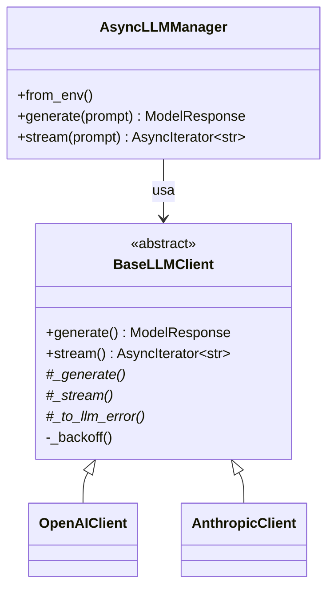

# Unified Async LLM Client

Cliente **asíncrono** y **robusto** en Python 3.12 que unifica **OpenAI** y **Anthropic** detrás de una
interfaz común. Elegís el proveedor con una variable de entorno y el resto del código no cambia.

```python
async with AsyncLLMManager.from_env() as llm:          # proveedor según LLM_PROVIDER
    resp = await llm.generate("¿Qué es la entropía?")   # respuesta completa
    async for token in llm.stream("¿Qué es la entropía?"):  # streaming token a token
        print(token, end="", flush=True)
```

## Características

| Requisito | Implementación |
|---|---|
| **Intercambiabilidad** | `BaseLLMClient` (clase abstracta) → `OpenAIClient` / `AnthropicClient`, elegidos por `AsyncLLMManager` según `LLM_PROVIDER` |
| **Asincronía** | SDKs oficiales en su versión async (`AsyncOpenAI`, `AsyncAnthropic`); esperas con `asyncio.sleep`, nunca `time.sleep` |
| **Streaming** | `stream()` es un generador asíncrono: `async for` sobre el stream del SDK + `yield` de cada fragmento |
| **Validación** | Pydantic v2 para mensajes (`ChatMessage`), configuración (`ModelConfig`: temperatura 0–2, `max_tokens`, `top_p`) y respuestas (`ModelResponse`) |
| **Errores controlados** | Rate limit, red, timeout, API key inválida, cuota agotada, etc. se devuelven como `LLMError` estructurado, con reintentos automáticos solo para errores transitorios |

---

## Arquitectura



- **Factory** (`AsyncLLMManager`): un registro `{Provider: Clase}` crea el cliente correcto. Agregar un proveedor
  nuevo es escribir su clase y sumar una línea al registro.
- **Template Method** (`BaseLLMClient`): los métodos públicos `generate()` / `stream()` implementan **una sola vez**
  la lógica de robustez (reintentos, backoff, latencia, conversión de errores). Cada proveedor implementa solo
  lo específico: `_generate()`, `_stream()` y `_to_llm_error()`.

### Estructura del repositorio

```
unified-llm-client/
├── llm_client/
│   ├── __init__.py           # exports públicos del paquete
│   ├── schemas.py            # modelos Pydantic: ChatMessage, ModelConfig, ModelResponse, LLMError, RetryPolicy
│   ├── base.py               # BaseLLMClient (ABC) + reintentos con backoff exponencial
│   ├── openai_client.py      # implementación OpenAI (AsyncOpenAI)
│   ├── anthropic_client.py   # implementación Anthropic (AsyncAnthropic)
│   ├── _errors.py            # traducción de excepciones de los SDKs a LLMError
│   └── manager.py            # AsyncLLMManager (factory) + carga de configuración
├── tests/                    # 93 tests con pytest (sin red ni API keys)
├── main.py                   # script de validación
├── .env.example              # plantilla de variables de entorno
├── pyproject.toml            # metadatos y configuración de pytest
├── requirements.txt
├── requirements-dev.txt      # + pytest, pytest-asyncio, pytest-cov
└── README.md
```

---

## Instalación

Requisitos: **Python 3.12** y una API key de OpenAI y/o Anthropic.

```bash
git clone <URL-de-este-repo>
cd unified-llm-client

# 1. Entorno virtual con Python 3.12
python3.12 -m venv .venv
source .venv/bin/activate          # Windows: .venv\Scripts\activate

# 2. Dependencias (openai, anthropic, pydantic, python-dotenv)
pip install -r requirements.txt

# 3. Variables de entorno
cp .env.example .env               # Windows: copy .env.example .env
# ...y editá .env con tu(s) API key(s)
```

## Variables de entorno

| Variable | Obligatoria | Default | Descripción |
|---|---|---|---|
| `LLM_PROVIDER` | No | `openai` | Proveedor activo: `openai` o `anthropic` |
| `OPENAI_API_KEY` | Si usás OpenAI | – | [Obtener key](https://platform.openai.com/api-keys) |
| `OPENAI_MODEL` | No | `gpt-4o-mini` | Modelo de OpenAI |
| `ANTHROPIC_API_KEY` | Si usás Anthropic | – | [Obtener key](https://platform.claude.com/settings/keys) |
| `ANTHROPIC_MODEL` | No | `claude-opus-5-5` | Modelo de Anthropic (más económico: `claude-haiku-5-5`) |
| `LLM_TEMPERATURE` | No | `0.7` | Entre 0 y 2 (solo OpenAI, ver [diferencias](#diferencias-entre-proveedores)) |
| `LLM_MAX_TOKENS` | No | `2048` | Entre 1 y 16384 |
| `LLM_MAX_RETRIES` | No | `3` | Reintentos ante errores transitorios (0 a 10) |

Solo hace falta la key del proveedor que vas a usar. Los valores se validan con Pydantic al arrancar: una
configuración inválida (`LLM_TEMPERATURE=5`, proveedor inexistente, key faltante) corta el programa con un mensaje claro.

> ⚠️ El archivo `.env` está en `.gitignore`. **Nunca subas tus API keys al repositorio.**

---

## Ejecutar el script de prueba

```bash
python main.py                        # usa el proveedor definido en LLM_PROVIDER
python main.py --provider anthropic   # fuerza un proveedor sin editar el .env
```

El script hace la pregunta *"¿Qué es la entropía?"* y ejecuta:

1. **Modo normal**: respuesta completa con tokens consumidos y latencia.
2. **Modo streaming**: el texto se imprime a medida que llega, y se mide el tiempo al primer token (TTFT).
3. **Error controlado**: llamada con una API key falsa a propósito; el programa informa el error y sigue.
4. **Bonus, en paralelo**: si hay keys de ambos proveedores, los consulta a la vez con `asyncio.gather`
   y compara el tiempo con el que habría tomado hacerlo en secuencia.

Salida de ejemplo (abreviada):

```
════════════════════════════════════════════════════════════
  1. Modo normal · anthropic (claude-opus-5-5)
════════════════════════════════════════════════════════════
La entropía mide el desorden de un sistema...
  ✅ anthropic/claude-opus-5-5 · tokens: 30 in / 25 out · 1075 ms

  2. Modo streaming · ...
  ✅ 16 fragmentos · primer token en 1.17s · total 1.17s

  3. Error controlado · API key inválida
  ❌ Error controlado [auth]: API key inválida o sin permisos. Revisá tu archivo .env.
     retryable=False · status=401

  4. Bonus · OpenAI y Anthropic en paralelo
  ⏱  En paralelo: 1.04s · secuencial habría tardado ~2.04s
```

---

## Tests

```bash
pip install -r requirements-dev.txt
pytest                                   # 93 tests, ~3 s
pytest --cov=llm_client                  # con reporte de cobertura (~98%)
```

Los tests **no usan red ni API keys** y no gastan créditos. Se le pasa a cada SDK un `http_client` con un
`MockTransport` que simula el servidor (ver `tests/fakes.py`). Así se ejercita el SDK real de punta a punta:
parseo de respuestas, streaming SSE y excepciones, con respuestas controladas. Qué cubren:

- **Validación** (`test_schemas.py`): rangos de temperatura, `max_tokens` y `top_p`, roles, inmutabilidad, backoff.
- **Robustez** (`test_base.py`): reintenta solo errores transitorios, se rinde tras `max_retries`, el streaming no
  reintenta después del primer token, y 5 llamadas concurrentes corren en paralelo (prueba de no bloqueo).
- **Proveedores** (`test_openai_client.py`, `test_anthropic_client.py`): formato de cada API, `system` separado en
  Anthropic, chunks vacíos, bloques de razonamiento, rechazos y cada código de error HTTP (401, 403, 404, 429, 500, 529, red, timeout).
- **Manager** (`test_manager.py`): selección por `LLM_PROVIDER`, errores de configuración e intercambiabilidad
  (el mismo código funciona con los dos proveedores).

---

## Uso como librería

```python
import asyncio
from dotenv import load_dotenv
from llm_client import AsyncLLMManager, ChatMessage, LLMClientError, ModelConfig

async def main():
    load_dotenv()
    async with AsyncLLMManager.from_env() as llm:
        # Respuesta completa: nunca lanza errores de API, se chequea `success`
        resp = await llm.generate("Explicá la entropía", system="Sos un profesor de física.")
        if resp.success:
            print(resp.content, resp.usage.total_tokens)
        else:
            print(f"Falló: {resp.error.type} - {resp.error.message}")

        # Conversación multi-turno con configuración propia
        history = [
            ChatMessage(role="user", content="¿Qué es la entropía?"),
            ChatMessage(role="assistant", content="Una medida del desorden."),
            ChatMessage(role="user", content="¿Y en teoría de la información?"),
        ]
        config = ModelConfig(model="gpt-4o-mini", temperature=0.2, max_tokens=300)

        # Streaming: ante un fallo lanza LLMClientError (nunca una excepción del SDK)
        try:
            async for token in llm.stream(history, config=config):
                print(token, end="", flush=True)
        except LLMClientError as exc:
            print(f"\nStream interrumpido: {exc.error.type}")

asyncio.run(main())
```

También se puede usar un cliente concreto directamente: `OpenAIClient(api_key=...)` / `AnthropicClient(api_key=...)`.

---

## Manejo de errores

Ninguna excepción de los SDKs escapa del cliente. Cada una se traduce a un `LLMError`:

| Situación | `error.type` | ¿Se reintenta? |
|---|---|---|
| Rate limit (429) | `rate_limit` | ✅ (respeta el header `Retry-After` si viene) |
| Timeout | `timeout` | ✅ |
| Sin conexión / error de red | `network` | ✅ |
| Error del servidor (5xx, 529 *overloaded*) | `api` | ✅ |
| API key inválida o sin permisos (401/403) | `auth` | ❌ |
| Cuota/saldo agotado (429 `insufficient_quota` de OpenAI) | `quota` | ❌ |
| Request inválida: modelo inexistente, parámetros (400/404/422) | `bad_request` | ❌ |
| El modelo se negó a responder (`stop_reason="refusal"`) | `refusal` | ❌ |

- **`generate()`** nunca lanza: devuelve `ModelResponse` con `success=False` y el `error` cargado.
- **`stream()`** lanza una única excepción propia, `LLMClientError`, con el `LLMError` en `.error`. Un generador
  que hace `yield` de texto no puede "devolver" también un objeto de error sin mezclar tipos.
- **Errores de configuración** (`LLMConfigError`) sí se lanzan, al crear el manager: son errores de quien
  configura, y conviene fallar rápido.

### Estrategia de reintentos

- **Backoff exponencial con *full jitter***: la espera es aleatoria entre 0 y `base_delay · 2^intento`
  (tope `max_delay`). El azar evita que muchos clientes reintenten todos a la vez y vuelvan a saturar la API.
- **Solo errores transitorios.** Reintentar una key inválida no tiene sentido: va a seguir siendo inválida.
- **Streaming: solo antes del primer token.** Si ya se emitió texto, reintentar duplicaría la respuesta
  ("La entropía La entropía es..."), así que el error se informa.
- **Los reintentos internos de los SDKs están desactivados** (`max_retries=0`) para no multiplicarlos con los
  propios (3 × 3 = 9 requests por fallo).

---

## Diferencias entre proveedores

Lo que la interfaz común "esconde":

| Aspecto | OpenAI | Anthropic |
|---|---|---|
| Mensaje `system` | Dentro de la lista de mensajes | Parámetro `system=` aparte (el cliente lo extrae) |
| `max_tokens` | Opcional (`max_completion_tokens`) | Obligatorio |
| Respuesta | `choices[0].message.content` | Lista de bloques; el cliente concatena los de tipo `text` |
| Streaming | Chunks con `delta.content` (algunos vacíos, se filtran) | `messages.stream()` + `text_stream` |
| `temperature` / `top_p` | Soportados (temperatura 0–2) | **No soportados** por los modelos actuales de Claude |
| Rechazos de seguridad | – | Respuesta 200 con `stop_reason="refusal"` |

**Sobre la temperatura en Anthropic:** los modelos actuales de Claude devuelven error 400 si se envían
`temperature` o `top_p`, y la versión 2.x del SDK ya no expone esos parámetros. La validación de 0 a 2 se mantiene
en `ModelConfig` y se aplica en OpenAI. En Anthropic el parámetro se ignora y se avisa por log, en lugar de romper la llamada.

**Fallbacks en Anthropic:** para los modelos que lo soportan (como `claude-opus-5-5`), el cliente activa los
*server-side fallbacks* (`fallbacks="default"`). Si el modelo rechaza una consulta inocente por un falso positivo
de seguridad, la API la reintenta con otro modelo dentro de la misma llamada.

**Modelos de razonamiento de OpenAI:** algunos (por ejemplo, la familia o-series) no aceptan valores
personalizados de `temperature`. Con esos modelos el cliente devuelve un error `bad_request` controlado.

---

## Solución de problemas

| Mensaje | Causa probable |
|---|---|
| `Falta la API key: definí OPENAI_API_KEY...` | No existe el `.env` o falta esa variable (`cp .env.example .env`) |
| `[auth] API key inválida o sin permisos` | Key mal copiada, revocada, o de otro proveedor |
| `[quota] Cuota agotada` | La cuenta no tiene saldo: revisá el billing del proveedor |
| `[bad_request] ...` | Nombre de modelo incorrecto en `OPENAI_MODEL` / `ANTHROPIC_MODEL` |
| `[network] Error de red` | Sin internet, firewall o proxy que bloquea la API |

Para ver el detalle HTTP de los SDKs: `OPENAI_LOG=debug` o `ANTHROPIC_LOG=debug`.
